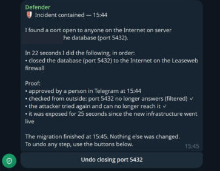
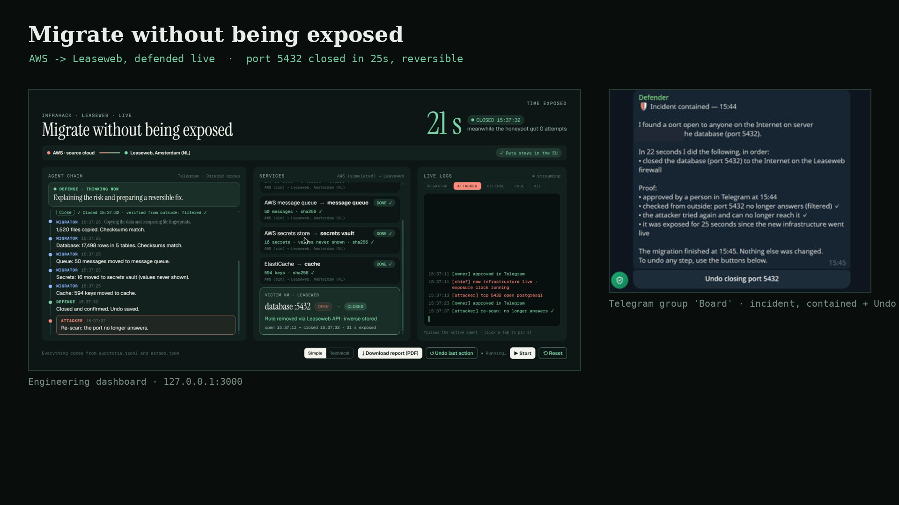
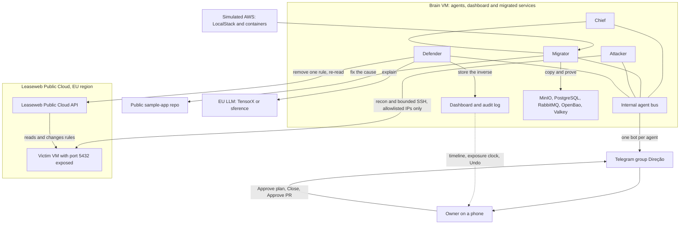
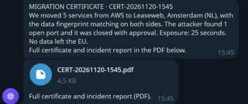
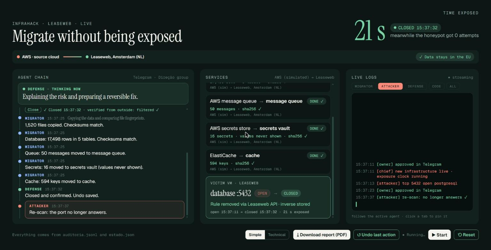

# Migrate without being exposed

**Move an app from AWS to Leaseweb while an attacker is already knocking — and close the window before it becomes a breach.**

[](LICENSE)
[](#team-and-hackathon)
[](#tech-stack)
[](#quickstart)

## The migration window is the open window

Leaving a hyperscaler is slow. In Leaseweb's **Digital Independence Survey 2026** (Censuswide, 800 executives in
the Netherlands, Germany, the UK and the US, at companies with 500–5,000 employees), only **11%** said they could
move away from their largest cloud provider within three weeks; **55%** would need more than three months or could
not move critical workloads at all ([ITPro](https://www.itpro.com/cloud/cloud-computing/nine-in-ten-businesses-cant-ditch-their-cloud-provider-heres-why),
[Channel Insider](https://www.channelinsider.com/infrastructure/leaseweb-cloud-migration-msp-strategy/)).

The move itself is where things get exposed. Misconfiguration is the leading cause of critical cloud incidents at
**45%**, nearly double credential theft at 22% — **SANS 2026 Cloud Security Survey**
([Infosecurity](https://www.infosecurity-magazine.com/news/cloud-security-maturity-lags-sans/)). And exposed
services are found in minutes: in **Unit 42's 2021** study of 320 honeypots, 80% were compromised within 24 hours,
and one actor reached 96% of 80 exposed Postgres honeypots within 30 seconds
([Unit 42](https://unit42.paloaltonetworks.com/exposed-services-public-clouds/); the study is from 2021).

A rushed migration is a machine that is new, half-configured, reachable from the whole internet, and nobody is
watching it. Small companies do not lack alerts. They lack someone to act on them at 2 a.m.

## What it is

A working, end-to-end demo built in one day: **four agents, each with its own Telegram bot**, move a small
e-commerce app and its Terraform from AWS to Leaseweb while an attacker probes the new infrastructure. The
Migrator copies five managed services live, with counts and checksums as proof. The Attacker touches only
machines on a closed IP allowlist. The Defender correlates the attack with the real security-group rules,
explains the risk in plain English using an EU-hosted LLM, and waits for the owner. One tap removes exactly
one firewall rule through the Leaseweb Public Cloud API; the close is verified from outside and the inverse
action is stored. The migration then finishes, the Migrator opens a pull request (or a dry-run diff) that fixes
the Terraform rule that caused the exposure, and the Chief issues a migration certificate generated from the audit
log.

Everything runs against the **real Leaseweb API**. The only simulated part is the AWS account, replaced by
LocalStack and containers so the demo is repeatable and costs nothing on the AWS side.
See [`docs/ARCHITECTURE.md`](docs/ARCHITECTURE.md) for the internals.



_The four agents and the owner during the incident. **In development** — screenshot to be captured; see the
[media shot list](docs/media/SHOTLIST.md)._

[](docs/media/demo.mp4)

_60–90 second demo video. **In development** — recording to be added._

## Architecture



The orchestrator (`code/orquestrador.ts`) is the runtime that calls the four agents; it is not a fifth bot.
Telegram is the stage: the agents talk to each other over an internal bus, and each one publishes its line in the
group with its own bot. Telegram bots cannot hear each other, so the bus — not the chat — is the transport.

**Lab topology.** The migrated services run in containers on the brain VM (the owner's server). A second
Leaseweb VM, the victim, carries the security group with `5432/tcp` open to the world and a harmless listener on
that port, so the firewall can be tested from outside. A host cannot test its own security group, which is why
the demo uses two machines. The Defender fixes the victim's security group through the API. A third VM, the
bait (the "isco"), is never attacked by the agent; it only counts real login attempts from the internet, shown
on `/isco`. In a real deployment the owner's server is one VM; the lab splits it so the defence can be proven
from outside.

## How it works

1. **Migrate.** The Migrator reads the sample app and its Terraform, then applies a **deterministic translation
   table** (not the LLM) to decide what moves and where. The destination decider picks self-hosted open services
   or an EU managed service using dated prices and simple rules. The owner gets one message with an
   **Approve plan** button. On approval, five services move live, each with proof: S3 → MinIO, RDS Postgres →
   PostgreSQL, SQS → RabbitMQ, Secrets Manager/SSM → OpenBao, ElastiCache Redis → Valkey. DynamoDB, SNS and
   CloudWatch Logs are in the plan for the next phase (**in development**). The same app tests run before and
   after, and an independent script compares source and target (`npm run seed:comparar -- --destino`).
2. **Attack.** As soon as the plan is approved, the Attacker probes the allowlisted VM in rounds while the copy
   runs. It opens short TCP connections to 13 ports, including SSH, databases, Redis, Elasticsearch and RDP,
   then tries a **short, bounded SSH password step** (at most 5 attempts per round, 800 ms apart, stopping at the
   first login). With `ATACANTE_EXTRAS=1` it also checks TLS and headers, factory-default credentials, a public
   bucket and secrets in the sample app's source. Everything is read-only: no sudo, no persistence, nothing
   written to the target.
3. **Detect and explain.** The Defender combines the Attacker's findings with the security-group rules read from
   the Leaseweb API. A rule with source `0.0.0.0/0` or `::/0` on a sensitive port is high severity. An
   EU-hosted, OpenAI-compatible LLM (TensorX or sference) writes the explanation: at most three sentences and
   600 characters. If it fails or takes more than 20 seconds, a backup provider is tried; if that fails, a fixed
   explanation per finding type is used, so the demo never waits on the AI.
4. **Respond, reversibly.** The owner gets a **Close** / **Ignore** message with the explanation. On approval,
   the Defender revokes **only that one rule** through the API, re-reads it, and confirms from outside with
   `nmap` that the port no longer answers (if the victim IPs are unknown, it falls back to the API state). It
   never swaps a whole security group, because that would replace every rule. The inverse (the rule to
   re-create) goes into `auditoria.jsonl`, and the message carries an **Undo** button and a `/desfazer <id>`
   command.
5. **Finish the migration.** The migration continues after the incident. The Chief sums up with measured numbers
   only, and the app tests and checksums are part of the proof. Nothing is reported as "done" if it was not
   measured; the fixed texts print "not measured".
6. **Fix the cause.** The Migrator's code agent scans the sample app for AWS usage and opens a pull request on the
   public app repo (`hack-leaseweb-exemplo-app`, branch `migracao/leaseweb-<time>`). The PR changes configuration
   only: it points the app at Leaseweb and corrects the Terraform rule that left the database open. The owner
   merges it with **Approve PR**, or `/desfazer` opens a PR that reverts it. A real PR requires
   `MIGRADOR_PR=real`, the target repo in `MIGRADOR_PR_REPO` and a fine-grained token in
   `GITHUB_TOKEN_EXEMPLO`; otherwise the run is a dry run.
7. **Prove it.** The Chief issues a migration certificate (`CERT-YYYYMMDD-HHMM`) built only from the audit log and
   the migration results: where each service landed, counts and checksums, what was found and closed, who
   approved it, exposure time and the stored inverse. It is sent in Telegram, the full report is attached as a
   PDF (`/relatorio.pdf`) and the certificate is shown at `/certificado`. The summary is assembled from the
   measured fields; the AI does not write the certificate. Missing fields say "not measured", and the document
   is a record for the owner and auditors, not a formal certification.



_The certificate at `/certificado`. **In development** — screenshot to be captured._

## The four agents

| Agent        | Code             | Job                                                                                                                                                               | What it is allowed to do                                                                       |
| ------------ | ---------------- | ----------------------------------------------------------------------------------------------------------------------------------------------------------------- | ---------------------------------------------------------------------------------------------- |
| **Chief**    | `code/chefe/`    | Coordinates the cycle, sums up with measured numbers, writes the certificate and the PDF report. It is the voice of the orchestrator.                             | Read state and audit log; write text and the certificate. No infrastructure changes.           |
| **Migrator** | `code/migrador/` | Analyses the app, translates Terraform, decides the destination, copies five services with proof, runs the app tests, opens the pull request.                     | `migrar` steps; `aprovar_pr` only when the owner taps **Approve PR**.                          |
| **Attacker** | `code/atacante/` | Reconnaissance and a bounded SSH password step against the allowlisted VM, plus read-only extras.                                                                 | Connect only to literal IPs in `ALVOS_PERMITIDOS`; no exploitation, no writes, no persistence. |
| **Defender** | `code/defesa/`   | Detects exposed rules, asks the LLM for plain words, requests approval, closes one rule, verifies from outside, stores the inverse, supports Undo and night mode. | `remover_regra` only, from a closed list; every change is reversible.                          |

The AI never chooses an action. The four agents can only ask for an item from a **closed action list** in
`code/shared/tipos.ts` (`remover_regra`, `migrar`, `aprovar_pr`), and the orchestrator executes it only after the
owner's tap. The model writes text; the code does the rest.

## Telegram and the dashboard

The owner talks to a team, not to a system:

- **Telegram group "Direção"**: the four bots and the owner. The Migrator proposes the plan, the Attacker reports
  what it found, the Defender explains and asks, the Chief closes with numbers. Each agent has its own bot and
  its own voice. (The Attacker can be switched to private messages with `TELEGRAM_ATACANTE_PRIVADO=sim`; the
  default is the group, so the whole chain is visible.)
- **Commands**: `/estado`, `/desfazer <pedidoId>`, `/atacar [ip]`, and `/recomendado` or `/selfhosted` before
  approving the plan. Buttons: `Approve plan`, `Close`, `Approve PR`, `Ignore`, plus one **Undo** per reversible
  step in the incident report.
- **Only the owner and the listed approvers can act.** Buttons and commands from anyone else are answered with
  "No permission." and ignored. `TELEGRAM_APROVADORES` exists so a guest (for example, a judge) can approve
  during the demo.
- **Night mode**: if the owner does not answer a _critical_ finding within `MODO_NOITE_MINUTOS`, the Defender
  applies a temporary, reversible measure without waiting: it first allows the same port only for the known IPs
  in `MODO_NOITE_IPS`, then closes the rule open to the world. Both steps are audited and Undo removes both.

The dashboard listens on `127.0.0.1:3000` by default (reach it over an SSH tunnel, or set `PAINEL_HOST` deliberately):

| Route            | What it shows                                                                                                                |
| ---------------- | ---------------------------------------------------------------------------------------------------------------------------- |
| `/`              | Engineering view: agent timeline, proofs, exposure clock, **Undo last action**, `Simple`/`Technical` toggle, PDF download.   |
| `/palco`         | The jury screen: phases migrate → attack → approve → close, the port state, the exposure clock and the proof, in large type. |
| `/isco`          | Real login attempts received by the bait VM since it was switched on, and the number of distinct IPs.                        |
| `/certificado`   | The migration certificate, ready to print.                                                                                   |
| `/relatorio.pdf` | The A4 report of the cycle: certificate plus incidents.                                                                      |
| `/estado.json`   | Requests and audit log, used by the page to refresh itself.                                                                  |
| `POST /desfazer` | Applies the inverse of a request. Only exists when `PAINEL_TOKEN` is set.                                                    |



_The engineering view at `/`. **In development** — screenshot to be captured._

## Safety and responsible use

- **Allowlist, fail-closed.** The Attacker only touches literal IPs in `ALVOS_PERMITIDOS`, and the check runs
  again before every connection. An empty list, a hostname, a CIDR or any other IP is refused. One attack runs
  at a time.
- **Bounded.** At most 5 SSH password attempts per round, 800 ms apart, stopping at the first login. No sudo, no
  persistence, no writes to the target. The `auth.log` proves the attempts; the password is never published.
- **Non-destructive.** No exploitation, no payloads, no lateral movement. The extras are read-only checks. The
  secrets scan reads the local sample app, not the target.
- **Reversible by design.** The Defender removes a single firewall rule and stores its inverse. Every reversible
  action has an Undo button and a `/desfazer` command. `aprovar_pr` stores the merge commit and opens a revert PR
  instead of pushing to `main`.
- **Smallest possible change.** One rule, then re-read. The defender never attaches or detaches a security group,
  because that replaces every rule at once.
- **Human in the loop.** Nothing changes without an approval tap from the owner or a listed approver. The single
  exception is night mode, limited to critical findings, with a temporary reversible rule and an explicit notice.
- **The AI only writes text.** Actions come from the closed list in code; model output is never executed.
- **Never copy the hole.** The Terraform translator refuses to carry `0.0.0.0/0` on sensitive ports
  (22, 23, 445, 1433, 3306, 3389, 5432, 5984, 6379, 9200, 27017) into the new configuration. It replaces them
  with the admin IP, or keeps the port closed until `ADMIN_IP` is set in `.env`.
- **Never leak secrets.** IAM users, roles and keys are flagged, not copied. Hard-coded keys and passwords in
  `user_data` are flagged by name with the value never shown. The secrets migration writes values straight into
  OpenBao and never to logs, plans or tests. The attacker redacts passwords from its own output.
- **No secrets in the repo.** Every key lives in `.env`, which is git-ignored; only `env/.env.example` is
  committed, and it contains no values.
- **Data stays in the EU.** The destination cloud is a Leaseweb EU region, and the LLM providers are EU-hosted.
  Telegram carries status messages, not the migrated records.
- **Use it only on machines you own.** This repository contains a working attacker. It refuses anything outside
  the allowlist by design; do not remove that guard. Every test during the hackathon ran against our own VMs,
  and the runbook requires telling the organisers before the attack runs on stage. Scanning systems you do not
  own is illegal in many jurisdictions.

## Quickstart

**Prerequisites**

| Piece                             | Why                                                                                            |
| --------------------------------- | ---------------------------------------------------------------------------------------------- |
| Node.js 22+ and npm 10+           | The agents are TypeScript run with `tsx`.                                                      |
| Docker with Compose               | The eight local containers: LocalStack, two Postgres, MinIO, RabbitMQ, Redis, Valkey, OpenBao. |
| `nmap`                            | The Defender confirms the close from outside. Without it, it falls back to the API state.      |
| `bash`                            | `npm run demo` and the preparation scripts are shell scripts. On Windows, use Git Bash or WSL. |
| A Leaseweb Public Cloud API key   | Reading and changing real firewall rules.                                                      |
| Four Telegram bots and a group    | One bot per agent, with the owner in the group.                                                |
| An OpenAI-compatible LLM endpoint | Optional; without it, the fixed explanation is used.                                           |

**Install and configure** (PowerShell)

```powershell
git clone https://github.com/guilhermepferreira0429/hack-leaseweb.git
Set-Location hack-leaseweb
npm install
Copy-Item env/.env.example .env
# Fill in .env: LSW_API_KEY, TELEGRAM_TOKEN_*, TELEGRAM_GRUPO_ID, TELEGRAM_DONO_ID,
# ALVOS_PERMITIDOS, LSW_SG_GERIDOS, LLM_*, and the local container passwords.
npm run typecheck
npm test
```

**Run**

```powershell
npm run infra:up                  # 8 containers, all bound to 127.0.0.1
npm run dev                       # orchestrator: agents + dashboard in one process
npm run dev -- --consola --uma-vez  # rehearsal: the terminal plays Telegram, exits after one cycle
npm run dev -- --sem-migrador     # cuts: also --sem-atacante, --sem-fila, --sem-segredos, --sem-cache
```

**Run a single piece while developing**

```powershell
npm run dev:painel                # dashboard on http://127.0.0.1:3000
npm run dev:migrador
npm run dev:atacante -- <ip>      # refused unless <ip> is in ALVOS_PERMITIDOS
npm run dev:defesa
npm run dev:exemplo
npm run telegram:smoke
```

**Prepare the demo data.** `npm run demo` runs `bash env/preparar-demo.sh` and then starts the orchestrator. On
Windows, use Git Bash or WSL, or run the preparation by hand in PowerShell:

```powershell
npm run infra:up
npm run seed:limpar-destino -- --sim   # empty the target only
npm run seed                          # deterministic sample data on the source
npm run seed:comparar                 # must be 10/10 against esperado.json
npm run dev
```

**Without a Leaseweb key**, `npm run lsw:falsa` starts a fake Leaseweb API on `127.0.0.1:4010` for rehearsals.
The victim VM is created once with `npm run lsw:vitima -- criar` (about €0.035/hour) and reset between runs with
`npm run lsw:vitima -- reabrir`. Full setup from zero, including the VM, the bots and the LLM:
[`docs/install.md`](docs/install.md). The neutral demo runbook is [`docs/RUNBOOK.md`](docs/RUNBOOK.md).

## Tech stack

| Layer                | What we used                                                                                                                                       |
| -------------------- | -------------------------------------------------------------------------------------------------------------------------------------------------- |
| Language and runtime | TypeScript 5.7, Node.js 22+, `tsx`, ES modules, no build step                                                                                      |
| Agents               | One Node process, an in-process event bus (`code/shared/bus.ts`), typed requests and a closed action list                                          |
| Cloud API            | Leaseweb Public Cloud v1 over `fetch`, `X-LSW-Auth`, asynchronous firewall operations                                                              |
| AWS side (simulated) | LocalStack, AWS SDK v3 clients for S3, SQS, SSM, Secrets Manager, DynamoDB and SNS, plus PostgreSQL, Redis, RabbitMQ, MinIO and OpenBao containers |
| Data migration       | AWS SDK, `pg`, `amqplib`, `redis`, checksums and row/key counts                                                                                    |
| Attack               | `ssh2` for the bounded SSH step; raw TCP sockets for recon                                                                                         |
| Defence              | Leaseweb firewall API, `nmap` for external verification, `auditoria.jsonl` for the inverse                                                         |
| AI                   | OpenAI-compatible chat-completions API, EU providers (TensorX or sference), 20 s timeout, fixed-text fallback                                      |
| Telegram             | Bot API over long polling, no webhook, no public URL needed                                                                                        |
| Dashboard            | `node:http`, server-rendered HTML, QR code via `qrcode`, PDF report, no web framework                                                              |
| Config               | `.env` only, git-ignored; `env/.env.example` documents every key without values                                                                    |

## Repository layout

```
code/
  index.ts          wires the real modules and starts the orchestrator
  orquestrador.ts   the cycle: migrate, attack, defend, approve, fix, report
  consola.ts        the terminal that plays Telegram in rehearsals
  shared/           types, bus, Leaseweb client, LLM client, Telegram, audit log, state, voices, messages
  chefe/            chief agent: summaries, exposure clock, certificate, PDF report
  migrador/         analyse, five copy steps with proof, verify, Terraform translator, code agent and PRs
  atacante/         allowlist, TCP recon, bounded SSH, read-only extras, secrets scan
  defesa/           detect, explain, approve, fix, undo, night mode, nmap verification, victim VM script
  painel/           dashboard: /, /palco, /isco, /certificado, /relatorio.pdf, /estado.json
  exemplo-app/      sample app that uses AWS services, with deterministic seed data and tests
docs/               architecture, runbook, install, API notes, research and team notes
env/                .env.example, docker-compose.yml, demo preparation and reset scripts
```

## Using the real Leaseweb API

This is not a mock. The Defender reads and changes real rules on the Leaseweb Public Cloud v1 API, and the demo
was developed against a real event account:

- **Base** `https://api.leaseweb.com/publicCloud/v1`, header `X-LSW-Auth`.
- **Endpoints used**: `GET /securityGroups`, `GET /securityGroups/{id}/firewallRules`,
  `POST /securityGroups/{id}/revokeFirewallRules`, `POST /securityGroups/{id}/authorizeFirewallRules` and
  `GET /instances/{instanceId}/securityGroups`.
- **Asynchronous by nature**: a revoke returns `202` and the rule sits in `DELETING`; an authorize goes
  `CREATING` → `ACTIVE` in about 7 seconds.
- **Measured on the day**: after a revoke, the port was already `filtered` in about 3 seconds, while the API kept
  listing the rule for about 39 seconds. That is why the Defender confirms from outside instead of trusting the
  API state.
- **One region in the event account**: `eu-central-1` (Frankfurt). The victim script defaults to it.
- **Never swap a security group.** Attaching a group replaces its rules, so the Defender only revokes the single
  offending rule and re-reads.

The EC2-compatible API is the migration path for load balancers (`CreateLoadBalancer` / `CreateListener`) and is
**in development**; it is not used in the demo. Endpoint notes and the exact test log are in
[`docs/leaseweb-api.md`](docs/leaseweb-api.md) and [`docs/research/leaseweb-api.md`](docs/research/leaseweb-api.md).

## Team and hackathon

Built from scratch at **Hackathon Portugal 2026 — InfraHack: AI for Cloud Infrastructure**, hosted by Leaseweb
with Velv, in Lisbon, on **20 November 2026**. The challenge: replace hyperscale services with automated
alternatives, without losing the data or the plot.

| Person                 | Area in this repo                                                                                             |
| ---------------------- | ------------------------------------------------------------------------------------------------------------- |
| **Guilherme Ferreira** | Agents and AI (LLM client, voices, orchestrator), state, Chief and Migrator, code migration and pull request. |
| **David Vieira**       | Telegram (four bots, group, bus) and the Attacker.                                                            |
| **Enio Carlos**        | Leaseweb VMs and API, Defence (including night mode), audit and dashboard.                                    |

No code was copied from other repositories; open-source frameworks are used as dependencies. The repository is
public and licensed under Apache 2.0.

## Documentation

- [`docs/ARCHITECTURE.md`](docs/ARCHITECTURE.md): the orchestrator, the bus, the AWS → Leaseweb translation rules,
  the detection and response sequence, the certificate and the audit log.
- [`docs/RUNBOOK.md`](docs/RUNBOOK.md): neutral, step-by-step runbook to reproduce the demo.
- [`docs/install.md`](docs/install.md): full setup from zero, including the brain VM, victim VM, bots and LLM.
- [`docs/leaseweb-api.md`](docs/leaseweb-api.md): the API endpoints and what we measured.
- [`docs/research/`](docs/research/README.md): the research behind the mapping, the detection rules and the numbers.
- [`docs/media/SHOTLIST.md`](docs/media/SHOTLIST.md): the screenshots and video still to be captured.
- [`docs/README.md`](docs/README.md): the full docs index, including the team's working notes.
- [`CONTRIBUTING.md`](CONTRIBUTING.md): how to run, change and test this repository.

## License

[Apache License 2.0](LICENSE). See [`NOTICE`](NOTICE) for the copyright and hackathon attribution.

The numbers in the opening section come from the sources cited there. The migration and incident figures in this
README (counts, checksums, exposure time) are measured during the run and written to `auditoria.jsonl`; the
bait-VM counter is read from `auth.log`.
