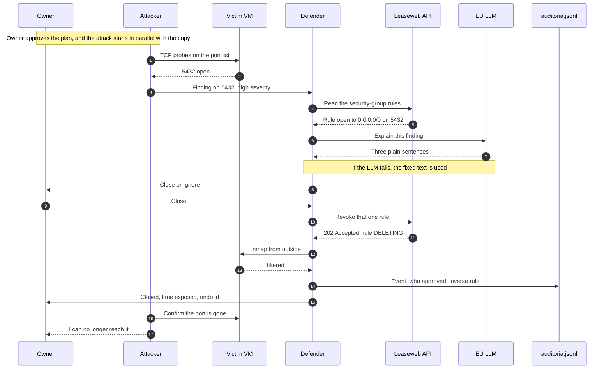

# Architecture

This document is the public architecture overview. It covers how the orchestrator and the agent bus work, the
AWS → Leaseweb translation rules, the detection and response path, the migration certificate and the audit log.
The lab layout (machines, containers, ports) and the team's operational notes are in
[`arquitetura.md`](arquitetura.md) (Portuguese, written during the event).

The demo has one hard constraint: **every action must come from a closed list in code and be reversible.** Most
of the design follows from that.

## One process, four agents

Everything runs in a single Node process on the brain VM. `code/index.ts` is the composition root: it reads
configuration, starts the dashboard, builds the real dependencies and calls `criarOrquestrador(deps, options)` in
`code/orquestrador.ts`.

The four agents are modules with narrow interfaces:

| Agent        | Module           | Responsibility                                                                                                                                   |
| ------------ | ---------------- | ------------------------------------------------------------------------------------------------------------------------------------------------ |
| **Chief**    | `code/chefe/`    | Opens and closes the cycle, sums up with measured numbers, builds the exposure clock, the certificate and the PDF report.                        |
| **Migrator** | `code/migrador/` | Analyses the app, translates Terraform, decides the destination, copies five services with proof, runs the app tests and opens the pull request. |
| **Attacker** | `code/atacante/` | Enforces the allowlist, probes the ports, runs the bounded SSH step and the read-only extras.                                                    |
| **Defender** | `code/defesa/`   | Detects exposed rules, asks for an explanation, requests approval, removes one rule, verifies, stores the inverse, supports Undo and night mode. |

The orchestrator injects the transport (`telegram` or the terminal), the bus, the state store, the audit log and
the agent modules. That is why `code/orquestrador.test.ts` can run the whole cycle with fakes, including a fake
Leaseweb API and a fake Telegram.

Two decisions are worth calling out:

- **The agents do not talk to each other directly.** They publish to the bus; the orchestrator decides what runs
  next.
- **The agents do not execute infrastructure changes by themselves.** They return a request (`Pedido`) with an
  action from the closed list; the orchestrator asks a human and then calls the module that applies it.

## The bus

The bus is in `code/shared/bus.ts`:

```ts
type Agente = 'chefe' | 'migrador' | 'atacante' | 'defesa';
type Mensagem = { de: Agente; para: Agente | 'dono' | 'todos'; texto: string; pedido?: Pedido };

enviar(m: Mensagem): void
aoReceber(a: Agente, cb: (m: Mensagem) => void): void
```

`enviar` delivers the message internally **and** publishes it in the Telegram group through the sender's bot.
The Telegram chat is the stage, not the transport. Telegram bots do not receive messages from other bots, so an
agent-to-agent conversation cannot happen in the chat; the bus is what makes the chain visible without pretending
the bots are talking to each other.

The same module also handles the awkward parts of having four bots in one group:

- **One bot answers a command.** In a group with privacy mode disabled, all four bots receive `/estado` or
  `/atacar`. `esteBotResponde` selects exactly one: the bot of the private conversation, the mentioned bot in the
  group, or the main bot when there is no mention.
- **Only approvers can act.** `TELEGRAM_DONO_ID` and `TELEGRAM_APROVADORES` are the only IDs whose button taps
  and commands are accepted. Everyone else gets "No permission."
- **Every callback is tied to a request.** `callback_data` is `aprovar:<id>`, `ignorar:<id>` or
  `desfazer:<id>`, so a stale button cannot trigger a different action.

Requests live in memory (`code/shared/estado.ts`); the audit log is the permanent record. A restart loses the
in-memory list, which is why the certificate is built from `auditoria.jsonl` and not from memory.

## The cycle

1. The Migrator analyses the sample app and its Terraform and publishes the plan. The owner gets one
   **Approve plan** request.
2. The approval covers the migration plan; the five copy steps are born approved by it and each one writes its
   own proof event.
3. On approval, the Attacker starts in parallel with the copy, in rounds (reconnaissance, SSH, extras). The
   Defender reacts between rounds, so the owner sees the attack and the answer while the migration is still
   running.
4. The Defender's requests are decided one by one (`Close` / `Ignore`). The migration finishes, the code agent
   opens a PR, the owner decides with **Approve PR**, and the Chief publishes the summary and the certificate.
5. If the owner does not answer in time, `ESPERA_DECISAO_MS` ends the wait for the summary. For a _critical_
   pending rule, the Defender can apply night mode (see below).

Options that change the cycle for rehearsals and cuts: `--sem-migrador`, `--sem-atacante`, `--sem-fila`,
`--sem-segredos`, `--sem-cache`, `--consola` and `--uma-vez`.

## AWS → Leaseweb translation

The translation is **deterministic**. It is a table in `code/migrador/tradutor/tabelas.ts`, not a model. The LLM
may explain a finding or answer the owner; it never chooses a destination or invents a price. The translator
produces a plan: it does not call the Leaseweb API by itself.

### What moves automatically

| AWS (Terraform)                  | Leaseweb                                               | Notes                                                                                                                                                                                                                                |
| -------------------------------- | ------------------------------------------------------ | ------------------------------------------------------------------------------------------------------------------------------------------------------------------------------------------------------------------------------------ |
| `aws_instance`                   | `POST /instances`                                      | Same family with an `lsw.` prefix (for example `m5.large` → `lsw.m5.large`), confirmed against `GET /instanceTypes`. If the family is not offered, the translator picks the nearest by vCPU and RAM and says so.                     |
| Public Ubuntu/Debian AMI         | `imageId` (for example `UBUNTU_22_04_64BIT`)           | Mapped by OS and version. Custom AMIs are flagged: rebuild from a base image and cloud-init.                                                                                                                                         |
| Region in the EU                 | Leaseweb region                                        | The catalogue default is `eu-west-3` (Amsterdam on Leaseweb; on AWS that name is Paris). The event account only accepted `eu-central-1` (Frankfurt) for instances, so the victim script defaults there. Confirm with `GET /regions`. |
| `aws_security_group` + `ingress` | `POST /securityGroups` and `authorizeFirewallRules`    | One Leaseweb rule per AWS CIDR.                                                                                                                                                                                                      |
| `user_data`                      | cloud-init                                             | Copied after a scan for hard-coded secrets and `PasswordAuthentication yes`.                                                                                                                                                         |
| `egress`                         | —                                                      | Leaseweb rules have no direction field; the translator flags it instead of pretending to carry it.                                                                                                                                   |
| `aws_lb` + listener              | EC2-compatible `CreateLoadBalancer` / `CreateListener` | **In development**; not used in the demo.                                                                                                                                                                                            |

### What replaces a locked-in managed service

| AWS                                   | Open alternative on Leaseweb | How the agent moves it                                                                                      |
| ------------------------------------- | ---------------------------- | ----------------------------------------------------------------------------------------------------------- |
| S3                                    | MinIO                        | Same S3 API: the app changes the endpoint and keys. Objects are copied and checked by count and checksum.   |
| SQS                                   | RabbitMQ                     | Queue recreated, producers and consumers switch client. In-flight messages are drained before the switch.   |
| RDS PostgreSQL                        | PostgreSQL                   | `pg_dump`/`pg_restore` (or logical replication for less downtime), then row counts and checksums per table. |
| Secrets Manager / SSM Parameter Store | OpenBao                      | Vault to vault. Values never appear in plans, logs or tests.                                                |
| ElastiCache Redis                     | Valkey                       | Keys copied with their TTL, checked by sampling.                                                            |

These five move live in the demo, with proof for each and one approval. DynamoDB, SNS and CloudWatch Logs are in
the plan only; their replacements (ScyllaDB Alternator, NATS, Loki + Grafana) are **in development**.

### What is flagged, not migrated

| AWS                                                              | Why                                                      | What the plan says                                                                      |
| ---------------------------------------------------------------- | -------------------------------------------------------- | --------------------------------------------------------------------------------------- |
| IAM users, roles and keys                                        | No equivalent, and copying credentials is the wrong move | No credentials copied; new ones must be created on the target.                          |
| Lambda, API Gateway, Cognito, Step Functions, custom AMIs        | Proprietary services or image formats                    | This needs redesign, not migration.                                                     |
| `0.0.0.0/0` on a sensitive port                                  | It is the hole we are trying to avoid                    | Replaced by the admin IP, or kept closed until `ADMIN_IP` is set.                       |
| Hard-coded keys and passwords in `user_data`, tags or attributes | They would leak into the new configuration               | Flagged by name, value never shown; the line is removed from the copied startup script. |
| `PasswordAuthentication yes` in `user_data`                      | Password SSH on a fresh VM                               | Flagged, with the fix (key-only SSH) written in the plan.                               |

The full mapping study, including the reasoning and the sources, is in
[`research/aws-to-leaseweb-mapping.md`](research/aws-to-leaseweb-mapping.md).

### Where each service goes

The destination decider (`code/migrador/tradutor/destino/`) applies rules in order:

1. High criticality and needs high availability → a managed service.
2. Does not fit the VM (RAM or disk below the minimum, with a 25% margin) → a managed service.
3. Personal data and the owner has no backups → a managed service.
4. Everything else → self-hosted on the Leaseweb VM.

Leaseweb comes first when it has the managed product. Otherwise the cheapest EU provider that meets the
requirements wins, using a price table with the date each price was seen. Missing prices are reported as "price
to confirm", not estimated. The owner can choose the recommended plan or "all self-hosted" from the dashboard;
the dashboard and the certificate page show which one was chosen.

## Detection and response

The Defender uses two signals:

1. **The control plane.** It reads the security-group rules in `LSW_SG_GERIDOS` from the Leaseweb API. A rule
   with source `0.0.0.0/0` or `::/0` on a sensitive port is high severity; any other port open to the world is
   medium. The bait VM and the brain are deliberately excluded: the bait has SSH open on purpose, and the brain
   needs SSH for the team.
2. **The attacker's findings.** The Attacker's TCP probes and extras arrive through the orchestrator and are
   correlated with the API findings by security group and IP. An attacker finding is only linked to a rule when
   the target IP belongs to that security group; without that proof it stays a warning and no rule is closed. This
   is what keeps the bait VM's deliberate SSH port out of the Defender's targets, and it removes duplicate
   findings for the same port.

The VM's `auth.log` is not the trigger for closing a rule. It is evidence: the bounded SSH step writes real
failed logins, the bait VM's `auth.log` feeds the live counter on `/isco`, and the report can use host evidence.
Host-level rules (brute force, then `Accepted` from the same IP) are **in development**; the demo's reversible
closed list currently contains firewall-rule and pull-request actions only.



### Verification, not optimism

The Leaseweb API is asynchronous. On the day we measured:

- a revoke returns `202` and the port stops answering in about **3 seconds**, but the rule stays listed as
  `DELETING` for about **39 seconds**;
- an authorize goes `CREATING` → `ACTIVE` in about **7 seconds**, and the port opens in about **4 seconds**.

Trusting the API state would leave the exposure clock running for an extra half minute. The Defender therefore
confirms the close from outside with `nmap` (the victim IPs come from `LSW_IP_SG` or from
`GET /instances/{id}/securityGroups`), and only falls back to the API state when it has no IP to test. Reads are
retried three times; a write is retried only if the connection never opened, so a retry cannot duplicate a rule.

### Night mode

Night mode is the only path that changes infrastructure without a tap. It is deliberately narrow:

- It only applies to a **pending** `remover_regra` request.
- The security group must be in `LSW_SG_GERIDOS`.
- The rule must be **critical**: a sensitive port open to `0.0.0.0/0` or `::/0`.
- `MODO_NOITE_MINUTOS` and `MODO_NOITE_IPS` must both be set; an empty or "world" IP fails closed.
- It first authorizes the same port for the known IPs, then revokes the rule open to the world, so the team is
  not locked out.
- Every step goes to the audit log with its inverse; `/desfazer` removes the temporary rules as well.

The orchestrator arms the timer when the request is created. If the owner answers first, the timer is cancelled.

## The audit log and the certificate

### The audit log

`auditoria.jsonl` is append-only: one JSON object per line, at the repository root, ignored by git because it
contains real targets and timestamps from the run. An event has:

```ts
type EventoAuditoria = {
  hora: string;
  pedidoId: string;
  tipo: string; // pedido, aprovado, ignorado, feito, falhou, desfeito, ...
  quem?: string; // owner id, 'defesa', 'modo-noite', 'dono'
  antes?: unknown;
  depois?: unknown;
  inverso?: Inverso; // how to undo it
};
```

The inverse is written **before** the change is applied. If the process dies between the write and the API call,
the Undo path still knows what to restore. The Defender also writes the confirmation method used (`api` or
`de-fora`) so the record shows how the close was verified.

### The certificate

`code/chefe/certificado.ts` builds the certificate from the audit log and the requests; it never reads a model
output and never invents a field. The identifier is `CERT-YYYYMMDD-HHMM` in Lisbon time. The sections are:

1. **Where the data is** — for each service, the AWS origin, the destination and `LOCAL_DADOS` (for example
   "Leaseweb, Frankfurt (DE)").
2. **Proof nothing was lost** — objects, rows, files, checksums before and after, and the app tests on both
   sides. A checksum mismatch is printed as a warning and the summary says the migration is not complete.
3. **Security after the migration** — what the attacker found, which rule was closed and when, who approved it
   (a person, or night mode), the exposure time and the attacker's confirmation.
4. **How to undo** — the requests with a stored inverse and the `/desfazer` command for each.

Missing values print `not measured`. The certificate contains counts, hashes, service names and the approver's
role, not secret values. It is a record for the owner and for an auditor; it is not a formal certification.

The same data is available in three places: the Telegram message, the printable page at `/certificado`, and the
A4 PDF from `/relatorio.pdf` (also sent to the group at the end of the cycle). The dashboard reads the same
`auditoria.jsonl`; no measured number is typed by hand.

The exposure clock is derived, not stored separately: from the last `infra-no-ar` event to the first confirmed
close. If no close happened, it keeps counting and the certificate says "still exposed".

## Failure modes

| Failure                            | What happens                                                                                                                                             |
| ---------------------------------- | -------------------------------------------------------------------------------------------------------------------------------------------------------- |
| LLM missing, slow or failing       | The client tries the backup provider (`LLM_*_2`), then uses a fixed explanation per finding type. The demo never waits more than 20 seconds per attempt. |
| `nmap` not installed               | The Defender confirms from the API state instead of from outside. The result is labelled `api` in the audit log.                                         |
| Leaseweb API read error            | Reads are retried three times. A write is not retried unless the connection never opened.                                                                |
| Another panel already on port 3000 | The orchestrator warns and keeps running without a second panel.                                                                                         |
| Empty or invalid allowlist         | The attack is refused; the rest of the cycle continues. An entry that is not a literal IP stops the attack at start instead of widening the fence.       |
| `LSW_SG_GERIDOS` empty             | Detection fails loudly with an error instead of reporting "nothing found", which would be a lie.                                                         |
| Two orchestrators on the same bots | Telegram returns `409 Conflict`; one run at a time is required. The smoke test and the runbook check for a leftover process.                             |
| Telemetry not measured             | The fixed messages print "not measured". Nothing is filled in for the demo.                                                                              |

## Where to read the code

| File                                | What it contains                                                         |
| ----------------------------------- | ------------------------------------------------------------------------ |
| `code/index.ts`                     | Composition root: real modules, env, panel, Telegram.                    |
| `code/orquestrador.ts`              | The cycle, approvals, night-mode timer, report publication.              |
| `code/shared/bus.ts`                | Agent-to-agent messages and group narration.                             |
| `code/shared/leaseweb.ts`           | The only place that talks to the Leaseweb API.                           |
| `code/shared/llm.ts`                | OpenAI-compatible client, timeout, backup provider, fixed-text fallback. |
| `code/shared/auditoria.ts`          | Append-only JSONL log.                                                   |
| `code/migrador/tradutor/tabelas.ts` | The deterministic AWS → Leaseweb tables.                                 |
| `code/defesa/detetar.ts`            | Rules, sensitive ports and correlation.                                  |
| `code/defesa/corrigir.ts`           | The single-rule close and its verification.                              |
| `code/defesa/modo-noite.ts`         | The temporary, reversible night-mode measure.                            |
| `code/chefe/certificado.ts`         | The certificate and the exposure clock inputs.                           |
| `code/painel/`                      | The dashboard, including `/palco`, `/isco` and `/certificado`.           |
